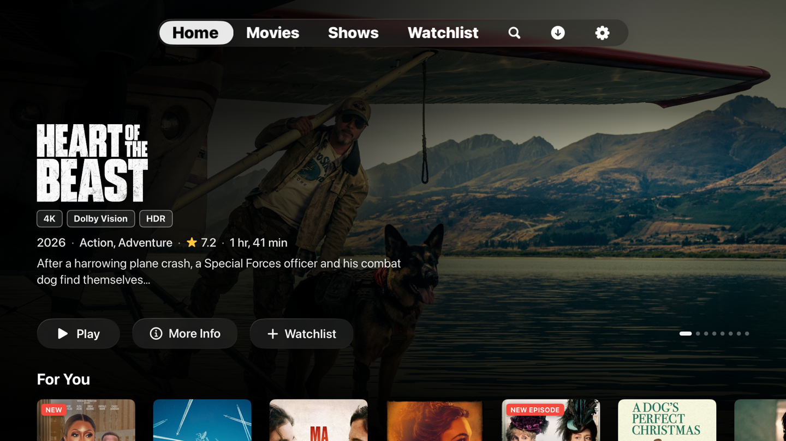
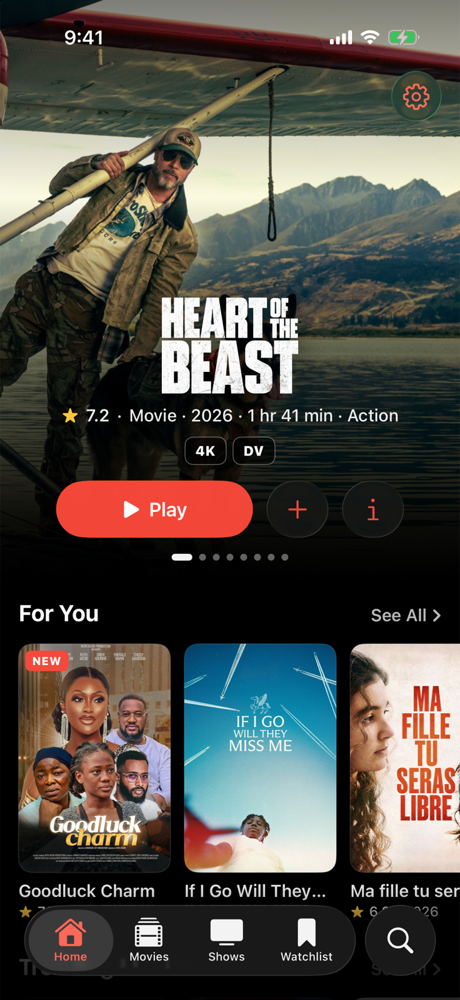
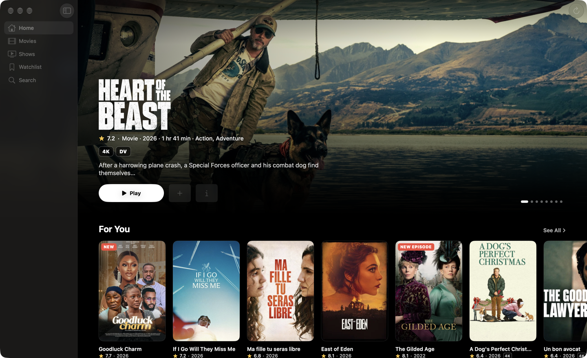

<p align="center">
  
</p>

<h1 align="center">PopcornTimeTV</h1>

<p align="center">
  Movies and shows over BitTorrent, played natively — in Dolby Vision and Dolby Atmos —<br>
  on Apple TV, iPhone, iPad and Mac.
</p>

<p align="center">
  <a href="CHANGELOG.md"></a>
  
  
  <a href="LICENSE.md"></a>
</p>

<p align="center">
  
</p>

<p align="center">
  
  &nbsp;&nbsp;
  
</p>

## Features

### Home
- Opens on **Home**: the featured releases, Continue Watching, new episodes of your shows,
  trending movies and shows, new in 4K, the Top 100 movies and shows, your Watchlist and your
  genres. Settings › Home picks the content languages and the rows.
- **For You**: titles picked for the profile watching, learnt on the device from what it
  watches and lists. Nothing is sent anywhere.
- **Streaming services**: with your own free TMDB key, a Services row shows what Netflix, Prime
  Video, Disney+ or Apple TV offer in your country; Popcorn Time plays those titles from its own
  sources.
- Pages open at once and fill in as their sources arrive; Liquid Glass pages on Apple TV and
  Mac.

### Playback — native first
- **True Dolby Atmos and HDR**: Matroska files are remuxed on the fly, while they download, for
  Apple's own player. Dolby Vision (profiles 5, 8.1, 8.4), HDR10, HDR10+ and HLG play as
  encoded; Dolby Digital Plus with Atmos reaches an Apple TV 4K's receiver untouched, and the
  Mac renders it spatially, AirPods included.
- Every compatible audio track and the file's own subtitles in the player, OpenSubtitles on
  demand.
- **Resume** where you left off, even in a film still downloading; far jumps and rewinds stay in
  the native player.
- **Episodes play on**: a Next Episode card, the next episode from the same release.
- A quality picker that weighs each release's bitrate against your connection.
- Films larger than the free space play anyway (Apple TV, Mac): only the part around the
  playhead is kept.
- VLC only as a last resort, for what Apple's player can't decode (TrueHD- or DTS-only files,
  AVI, MPEG-TS…). Details in [Supported formats](docs/TECHNICAL.md#supported-formats).

### Profiles
- Up to five profiles, **Who's Watching?** at launch, each with its own history, Continue
  Watching, watchlist and languages.
- **Your Preferences** shows what a profile's taste has learnt, and resets it.

### Languages
- Releases in your audio language come first, marked by one quiet tag (FR, IT… or MULTI).
- Audio and subtitles on **Automatic** follow the language a profile picks most in the player.
- The app speaks English, French, Spanish, Italian, Arabic and Brazilian Portuguese.

### Sources and search
- Movies from YTS and Torrentio, shows from EZTV and TVMaze, more releases from The Pirate Bay
  and Knaben, every IMDb title through Cinemeta; The Pirate Bay's Top 100.
- One search for movies and shows together, on every app.

### Apple TV and Mac
- **Top Shelf**: with Popcorn Time in the top row, the Apple TV home screen shows the latest
  releases full screen, ready to play.
- The Siri Remote: Play/Pause on a poster plays it, a long press opens its shortcuts, Menu goes
  back to Home.
- A native Mac app with its own menus and shortcuts (⌘1 Home, ⇧⌘P Switch Profile).

What changed in each version is in the [changelog](CHANGELOG.md).

## Platforms and requirements

| App | Runs on | Scheme |
|---|---|---|
| Apple TV | tvOS 17 or later (built for tvOS 26) | `PopcornTimetvOS` |
| iPhone and iPad | iOS / iPadOS 26 or later, and Macs with Apple silicon (Designed for iPad) | `PopcornTimeiOS` |
| Mac | macOS 14 or later | `PopcornTimeMac` |

Dolby Atmos and Dolby Vision passthrough need an **Apple TV 4K** with a compatible TV or
receiver. Building needs Xcode 26 or later and [CocoaPods](https://cocoapods.org).

## Build

```bash
git clone https://github.com/Radiomyme/PopcornTimeTV.git
cd PopcornTimeTV
pod install                  # fetching MobileVLCKit / TVVLCKit takes a while
open PopcornTime.xcworkspace
```

Pick a scheme from the table above and run. PopcornTorrent, the torrent engine of the three
apps, and GCDWebServer are Swift packages that Xcode resolves on its own. Keep the checkout out
of an iCloud-synced folder ([why](docs/TECHNICAL.md#building)).

## Tests

The app's unit tests run on the Mac in seconds, offline, on recorded answers: ⌘U on the
**PopcornTimeTests** scheme, or from the terminal for everything at once, PopcornTorrent's own
suites included. The Apple TV UI tests (**PopcornTimetvOSUITests**) drive the app with the
Siri Remote on a simulator. Suites, modes and timings are in
[docs/TECHNICAL.md](docs/TECHNICAL.md#tests).

```bash
tools/run-tests.sh
```

## Credits

- **[PopcornTimeTV](https://github.com/PopcornTimeTV/PopcornTimeTV)**, the original project this
  fork is built on.
- **[RougeCiel](https://github.com/RougeCiel)**, for 5.4.0: smoother lists in the Apple TV
  player ([#9](https://github.com/Radiomyme/PopcornTimeTV/pull/9)), releases in your audio
  language ([#10](https://github.com/Radiomyme/PopcornTimeTV/pull/10)), one search on Apple TV
  ([#11](https://github.com/Radiomyme/PopcornTimeTV/pull/11)), profiles
  ([#12](https://github.com/Radiomyme/PopcornTimeTV/pull/12)) and For You
  ([#13](https://github.com/Radiomyme/PopcornTimeTV/pull/13)), after the streaming services and
  the Apple TV fixes of [#6](https://github.com/Radiomyme/PopcornTimeTV/pull/6) to
  [#8](https://github.com/Radiomyme/PopcornTimeTV/pull/8).
- **[Radiomyme](https://github.com/Radiomyme)**, who maintains this fork.
- The libraries listed in [NOTICE.md](NOTICE.md): among them
  [PopcornTorrent](https://github.com/Radiomyme/PopcornTorrent) (libtorrent),
  [VLCKit](https://code.videolan.org/videolan/VLCKit) and
  [GCDWebServer](https://github.com/alextud/GCDWebServer).
- Data from YTS, EZTV, TVMaze, Torrentio, The Pirate Bay, Knaben, Cinemeta, metahub and
  OpenSubtitles; streaming services from JustWatch through TMDB. This product uses the TMDB API but is not endorsed or certified by
  TMDB.

## License

If you distribute a copy or make a fork of the project, you have to credit this project as source.

This program is free software: you can redistribute it and/or modify it under the terms of the GNU
General Public License as published by the Free Software Foundation, either version 3 of the License,
or (at your option) any later version.

This program is distributed in the hope that it will be useful, but WITHOUT ANY WARRANTY; without even
the implied warranty of MERCHANTABILITY or FITNESS FOR A PARTICULAR PURPOSE. See the GNU General
Public License for more details.

You should have received a copy of the GNU General Public License along with this program. If not,
see http://www.gnu.org/licenses/.

Note: some dependencies are external libraries, which might be covered by a different license
compatible with the GPLv3. They are mentioned in [NOTICE.md](NOTICE.md).

**This project and the distribution of this project is not illegal, nor does it violate _any_ DMCA
laws. The use of this project, however, may be illegal in your area. Check your local laws and
regulations regarding the use of torrents to watch potentially copyrighted content. The maintainers
of this project do not condone the use of this project for anything illegal, in any state, region,
country, or planet. _Please use at your own risk_.**

***

Released under the [GPL v3 license](LICENSE.md).
